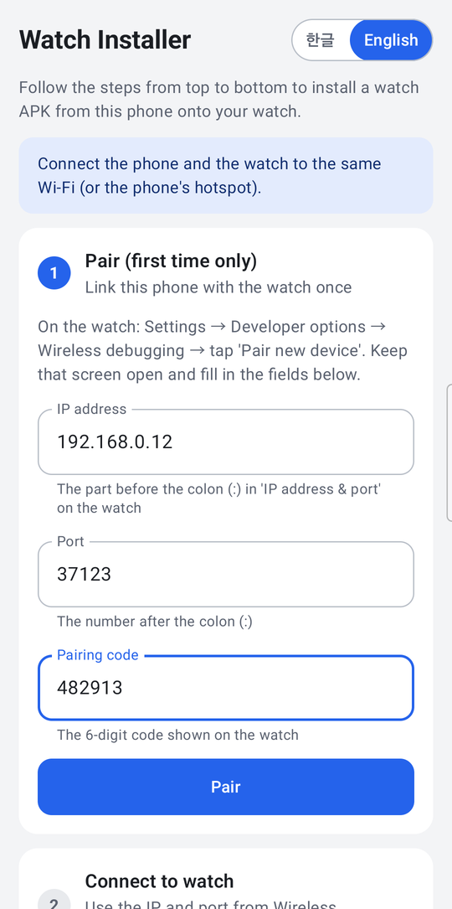
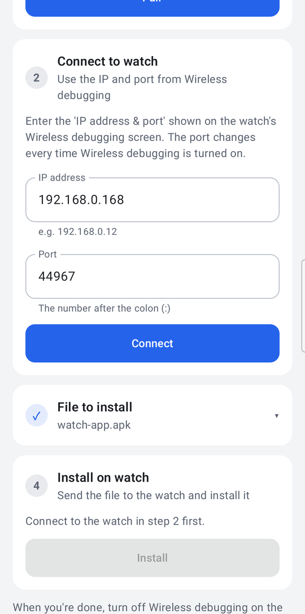
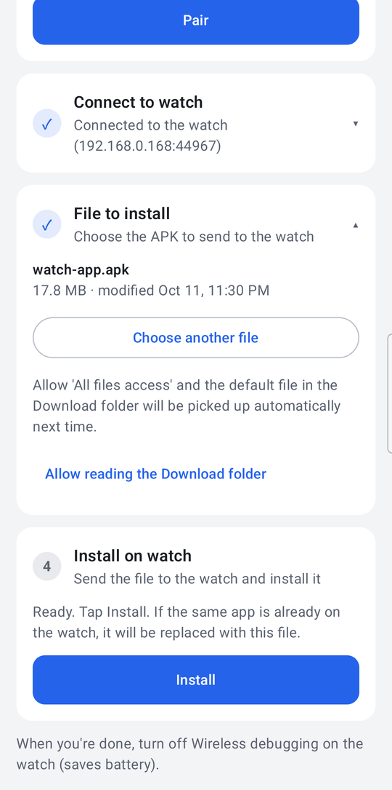
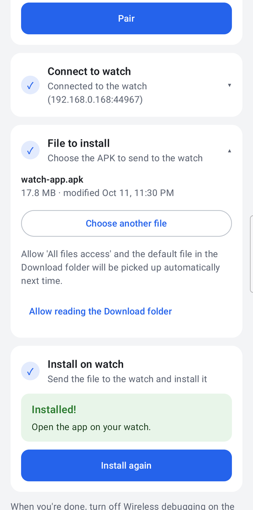

[한국어](README.md) | **English**

# Watch Installer

An Android app that **installs APKs on a Wear OS watch from your phone**.
No PC needed: the phone connects to the watch over Wireless debugging and installs a watch APK that's on the phone.
The screen can be switched between 한글 and English at the top right.

## Install (put this app on your phone)

It's not on any store. Clone this repository, build it, and install it on your phone yourself. Pick whichever method you prefer.

First, enable USB debugging on the **phone**: Settings → About phone → Software information → tap **Build number** 7 times → Settings → Developer options → turn on **USB debugging**.

### Method 1. Build and install with Android Studio

1. Install and launch [Android Studio](https://developer.android.com/studio).
2. Choose **File → Open** and select this repository folder (`watch-installer`). If "Trust Project?" appears, click **Trust Project**.
3. Wait until the **Gradle Sync** progress at the bottom of the window finishes (the first time takes a few minutes). If it asks you to install an SDK, go ahead and install it.
4. Connect the phone to the PC with a USB cable. When the phone asks "Allow USB debugging?", tap **Allow**.
5. In the toolbar at the top, make sure the run configuration is **app**, and pick **your phone** in the device list next to it.
6. Click the green **▶ (Run 'app')**. When the build finishes, "Watch Installer" is installed on the phone and opens.

### Method 2. Build and install from a terminal

You need the Android SDK and `adb` (`ANDROID_HOME`, or `sdk.dir` in `local.properties`).

```powershell
cd watch-installer
.\gradlew.bat assembleDebug        # macOS/Linux: ./gradlew assembleDebug
adb install -r app\build\outputs\apk\debug\app-debug.apk
```

## Prepare (watch)

1. **Turn on Developer options** — on the watch, Settings → About watch → Software information → tap **Software version** 7 times.
2. **Turn on debugging** — Settings → Developer options → turn on **ADB debugging** and **Wireless debugging**.

### Connect to the same Wi-Fi

Connect the phone and the watch to the **same Wi-Fi**. If there's no router, or the Wi-Fi blocks devices from talking to each other (guest, office, or school networks), turn on the phone's **mobile hotspot** and connect the watch to that hotspot.

- Watch Wi-Fi: Settings → Connections → Wi-Fi (being connected only over Bluetooth isn't enough — turn on Wi-Fi and connect).

## Usage

The app shows four step cards from top to bottom. A finished step collapses to one line with a ✓; tap it to open it again.

### 1. Pair (first time only)



1. On the watch, go to **Settings → Developer options → Wireless debugging → Pair new device**.
2. The watch shows an `IP address:port` and a **6-digit pairing code**. Keep that screen on (the code changes if it turns off).
3. In card 1, enter the **IP address**, the **port** (the number after the colon) and the **pairing code**, then tap **Pair**.
   - You can paste `192.168.0.12:37123` into the IP field and it will be split for you.
4. You only pair once. If you reset the watch or the connection keeps getting refused, use **Pair again**.

<br clear="right">

### 2. Connect to watch



1. Close the pairing dialog and look at `IP address & port` on the **main Wireless debugging screen** of the watch.
   - **This port is different from the pairing port**, and it changes every time Wireless debugging is turned on.
2. Enter the IP and port in card 2 and tap **Connect**. If the watch is found on the same Wi-Fi, the fields are filled in for you.
3. If the watch asks "Allow debugging?", tap **Allow** (check "Always allow" to skip it next time).

<br clear="right">

### 3. Choose the file to install



1. Tap **Choose another file** and pick the APK on your phone. Check the name, size and modified time.
2. With **Allow reading the Download folder** ('All files access') on, the default file in the Download folder is picked up automatically next time.
3. When moving an APK from a PC to the phone, **copy it with the PC's file explorer**. Files pushed with `adb push` may not be readable by other apps (the app will ask you to choose the file again).

<br clear="right">

### 4. Install on watch



1. Tap **Install**: sending (%) → installing → result. If the same app is already on the watch, it is replaced.
2. When **Installed!** appears, open the app on your watch.
3. If it fails, the reason and what to do are shown in one line (same Wi-Fi? did you tap Allow on the watch? is the same app with a different signature installed? …).
4. When you're done, **turn off Wireless debugging** on the watch (saves battery).

<br clear="right">

---

Developer notes (build setup, libraries, code structure, limitations) are in [docs/DEVELOPMENT.md](docs/DEVELOPMENT.md) (Korean).
License: [Apache-2.0](LICENSE).
