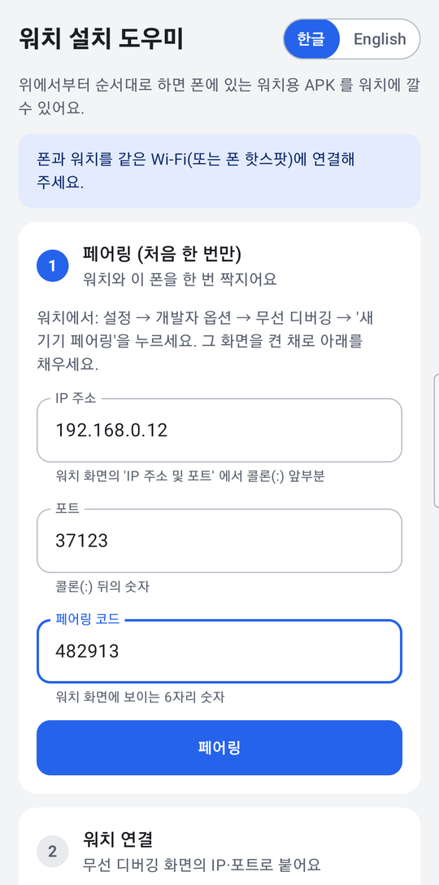
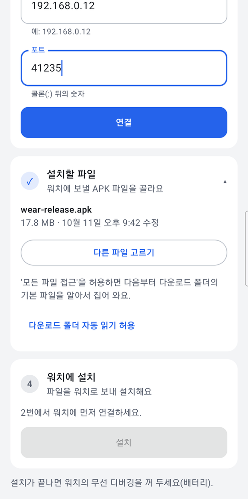
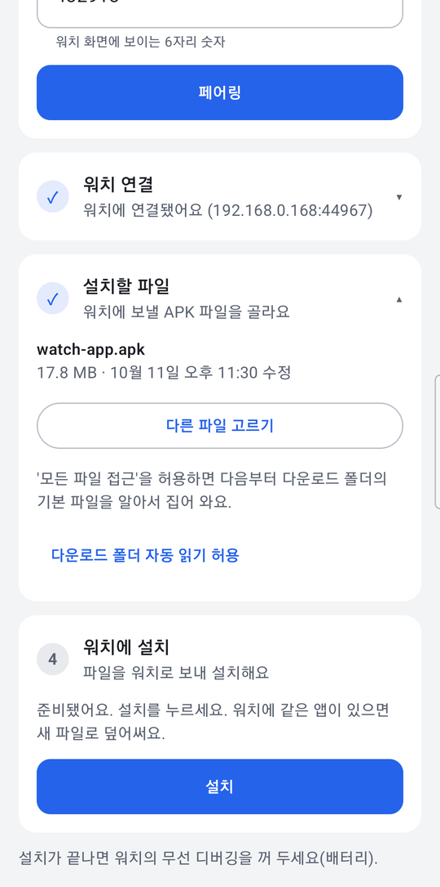
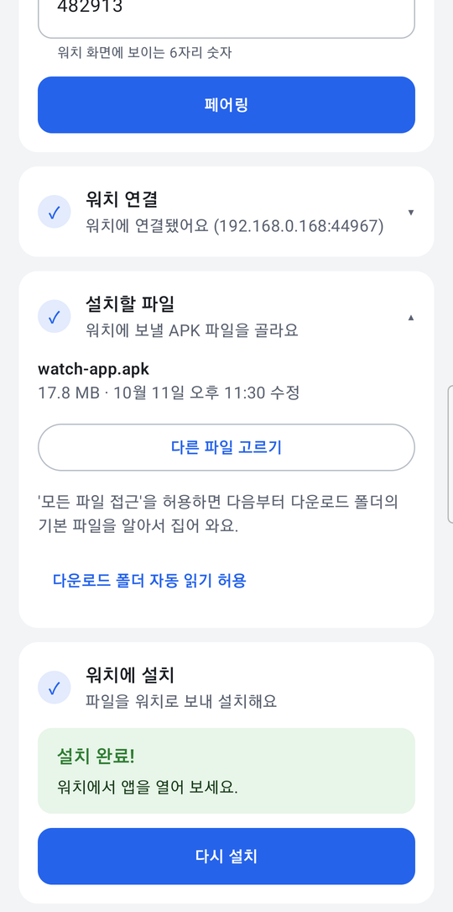

**한국어** | [English](README.en.md)

# 워치 설치 도우미

폰에서 **Wear OS 워치에 APK 를 설치**하는 안드로이드 앱이다.
PC 없이도 폰이 워치의 무선 디버깅에 붙어서, 폰에 있는 워치용 APK 를 워치에 깔아 준다.
화면은 한글/English 를 오른쪽 위에서 바꿀 수 있다.

## 설치 (폰에 이 앱 깔기)

스토어에는 없다. 이 저장소를 받아 직접 빌드해서 폰에 설치한다. 두 방법 중 편한 쪽으로 한다.

먼저 **폰**에서 USB 디버깅을 켠다: 설정 → 휴대전화 정보 → 소프트웨어 정보 → **빌드 번호**를 7번 탭 → 설정 → 개발자 옵션 → **USB 디버깅** 켜기.

### 방법 1. Android Studio 로 빌드·설치

1. [Android Studio](https://developer.android.com/studio) 를 설치하고 실행한다.
2. **File → Open** 에서 이 저장소 폴더(`watch-installer`)를 고른다. "Trust Project?" 가 뜨면 **Trust Project**.
3. 창 아래쪽에 **Gradle Sync** 진행 표시가 끝날 때까지 기다린다(처음엔 몇 분 걸린다). SDK 를 설치하라는 안내가 뜨면 그대로 설치한다.
4. 폰을 USB 로 PC 에 연결한다. 폰에 "USB 디버깅을 허용하시겠습니까?" 가 뜨면 **허용**.
5. 창 위쪽 도구 막대에서 실행 구성이 **app** 인지 확인하고, 그 옆 기기 목록에서 **내 폰**을 고른다.
6. 초록색 **▶ (Run 'app')** 를 누른다. 빌드가 끝나면 폰에 "워치 설치 도우미" 가 깔리고 바로 열린다.

### 방법 2. 터미널로 빌드·설치

Android SDK 와 `adb` 가 있어야 한다(`ANDROID_HOME` 또는 `local.properties` 의 `sdk.dir`).

```powershell
cd watch-installer
.\gradlew.bat assembleDebug        # macOS/Linux: ./gradlew assembleDebug
adb install -r app\build\outputs\apk\debug\app-debug.apk
```

## 준비 (워치)

1. **개발자 옵션 켜기** — 워치 설정 → 워치 정보(또는 '정보') → 소프트웨어 정보 → **소프트웨어 버전**을 7번 탭.
2. **디버깅 켜기** — 설정 → 개발자 옵션 → **ADB 디버깅**, **무선 디버깅** 켜기.

### 같은 Wi-Fi 에 연결하기

폰과 워치를 **같은 Wi-Fi** 에 연결한다. 공유기가 없거나 기기끼리 통신을 막는 Wi-Fi(게스트망·회사망·학교망)면 폰의 **모바일 핫스팟**을 켜고 워치를 그 핫스팟에 연결한다.

- 워치 Wi-Fi: 설정 → 연결 → Wi-Fi (블루투스로만 붙어 있으면 안 된다 — Wi-Fi 를 직접 켜서 연결).

## 사용법

앱을 열면 4단계 카드가 위에서 아래로 있다. 끝난 단계는 ✓ 와 함께 한 줄로 접히고, 누르면 다시 펼쳐진다.

### 1. 페어링 (처음 한 번만)



1. 워치에서 **설정 → 개발자 옵션 → 무선 디버깅 → 새 기기 페어링**을 누른다.
2. 워치 화면에 `IP 주소:포트` 와 **6자리 페어링 코드**가 뜬다. 이 화면을 켠 채로 둔다(꺼지면 코드가 바뀐다).
3. 앱 1번 카드에 **IP 주소**, **포트**(콜론 뒤 숫자), **페어링 코드**를 넣고 **페어링**.
   - `192.168.0.12:37123` 처럼 통째로 IP 칸에 붙여 넣어도 나눠 들어간다.
4. 한 번 짝지으면 다음부터는 건너뛴다. 워치를 초기화했거나 연결이 계속 거부되면 **페어링 다시 하기**.

<br clear="right">

### 2. 워치 연결



1. 페어링 창을 닫고 워치 **무선 디버깅 첫 화면**의 `IP 주소 및 포트` 를 본다.
   - **페어링 때와 포트가 다르다.** 포트는 무선 디버깅을 켤 때마다 바뀐다.
2. 2번 카드에 IP·포트를 넣고 **연결**. 같은 Wi-Fi 에서 워치를 찾으면 자동으로 채워 준다.
3. 워치에 "디버깅을 허용할까요?" 가 뜨면 **허용**(항상 허용을 체크하면 다음부터 안 묻는다).

<br clear="right">

### 3. 설치할 파일 고르기



1. **다른 파일 고르기**로 폰의 APK 를 고른다. 이름·크기·수정 시각으로 맞는 파일인지 확인한다.
2. **다운로드 폴더 자동 읽기 허용**('모든 파일 접근')을 켜 두면 다음부터 다운로드 폴더의 기본 파일을 알아서 집어 온다.
3. PC 에서 폰으로 APK 를 옮길 때는 **PC 탐색기로 복사**한다. `adb push` 로 넣은 파일은 다른 앱이 읽지 못할 수 있다(앱이 '다시 골라 주세요' 로 알려 준다).

<br clear="right">

### 4. 워치에 설치



1. **설치**를 누르면 보내는 중(%) → 설치 중 → 결과 순서로 나온다. 워치에 같은 앱이 있으면 덮어쓴다.
2. **설치 완료!** 가 뜨면 워치에서 앱을 열어 본다.
3. 실패하면 이유와 할 일이 한 줄로 나온다(같은 Wi-Fi 인지, 워치에서 허용을 눌렀는지, 서명이 다른 같은 앱이 깔려 있는지 등).
4. 끝나면 워치의 **무선 디버깅을 끈다**(배터리).

<br clear="right">

---

개발자용 내용(빌드 구성·라이브러리·코드 구조·한계)은 [docs/DEVELOPMENT.md](docs/DEVELOPMENT.md).
라이선스: [Apache-2.0](LICENSE).
